# Dota 2 · Аналитика игровой меты: Roshan, Winner, Duration

Командный проект буткемпа по Data Engineering (Томск, 12–15 ноября 2026, команда №5).
Три аналитических кейса на данных матчей Dota 2: от сырых событий в PostgreSQL и MongoDB до витрин в Iceberg, статистических проверок, ML-моделей и дашбордов в Superset.

---

## Бизнес-задача

Заказчик, аналитический отдел киберспортивной организации, получает большой объём разрозненных игровых событий. Без единой модели данных трудно быстро ответить, какие действия связаны с победой, как контроль Рошана влияет на исход и какие ранние события помогают оценить длительность матча.

**Цель:** превратить сырые события в проверяемые показатели, воспроизводимые витрины и дашборды.

---

## Результаты: технические и бизнес-выводы

| Кейс | Технический результат | Что это значит для бизнеса |
|---|---|---|
| **03 · Roshan** | Первый Рошан у Radiant: **76,5%** побед против **26,0%**, если его взял Dire (база 52,7%). После первого Рошана наступает плато (~74–77%) | Первый Рошан стоит читать как маркер перевеса, а не как причину победы. Оценивать команду лучше по **доле контроля**, а не по числу убитых Рошанов. В затяжных матчах (60+ минут) показатель почти не различает команды |
| **16 · Winner** | Random Forest на признаках первых 15 минут: ROC-AUC **0,812**, accuracy **73,0%** против 52,8% у baseline. Главный сигнал: золото | Раннее преимущество по золоту годится как сигнал для live-аналитики и ранжирования матчей по вероятности победы. Как гарантированный прогноз его использовать рано: нужны временная валидация и калибровка |
| **19 · Duration** | Gradient Boosting: MAE **361 с** против 532 с у медианного baseline (**−32%**), R² **0,50** | Ошибка около 6 минут при медианной длительности матча в тесте 35,4 мин. Для ориентировочного планирования аналитики и контента подходит, как бизнес-инструмент пока нет: не сравнили со средним по режиму игры |

**Сквозные выводы для заказчика:**
- Единая модель данных готова: путь PostgreSQL / MongoDB → RAW → STAGE → MART → дашборд описан, а ER-модель и lineage зафиксированы как артефакты.
- Главный риск аналитики лежит в данных: ключи между системами, дубликаты, покрытие (gold events примерно у 62% матчей Duration, около 5% событий Roshan без определённой стороны). Поэтому проверки и coverage-флаги нужны на каждом слое.
- Чтобы цифры были воспроизводимыми, нужно зафиксировать срез данных и SLA обновления витрин (пайплайн заявлен на запуск раз в час).

Для Winner и Duration в признаки попадают только события из окна `[0, 900)` секунд, чтобы исключить утечку будущего.

> **Главный вывод:** данные и процессы важнее модели. Корректные ключи, покрытие событий и честная база сравнения дают больше, чем усложнение алгоритма.

---

## Инфраструктура

Работали на lakehouse-платформе буткемпа: данные из PostgreSQL и MongoDB попадают в RAW, Spark превращает их в STAGE и MART (всё в Iceberg поверх S3), Trino даёт SQL-доступ, Superset рисует дашборды, а Airflow управляет запусками.

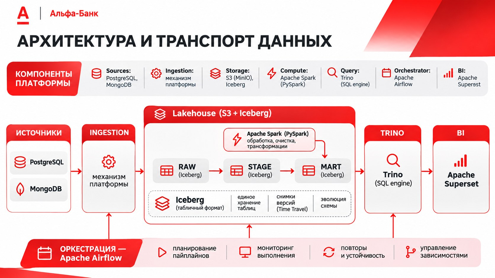

| Слой | Технология | Что делает |
|---|---|---|
| Источники | PostgreSQL, MongoDB | Матчи, игроки (PostgreSQL) и игровые события (MongoDB) |
| Ingestion | Механизм платформы | Загрузка источников в RAW |
| Хранилище | S3 (MinIO) + Apache Iceberg | Слои RAW / STAGE / MART; единое хранение таблиц, снимки версий (time travel), эволюция схемы |
| Вычисления | Apache Spark (PySpark) | Обработка, очистка, трансформации |
| SQL-доступ | Trino | Запросы к витринам из ноутбука и Superset |
| Оркестрация | Apache Airflow | Планирование пайплайнов, мониторинг, повторы, зависимости задач |
| BI | Apache Superset | Три дашборда по кейсам |
| Lineage | OpenLineage / Marquez | Граф происхождения данных от источников до витрин |

Аналитика и модели: Python (pandas, scikit-learn, scipy, matplotlib) в Colab. Задачи команды вели в Linear.

---

## Данные

Источники: PostgreSQL (`matches`, `match_players`, `players`, `npcs`) и MongoDB (события: `cs_events`, `gold_events`, `kill_events`). Данные о матчах и игроках связываются по `match_id`, а события привязываются к игрокам через `account_id` ⇄ `steam_account_id`.

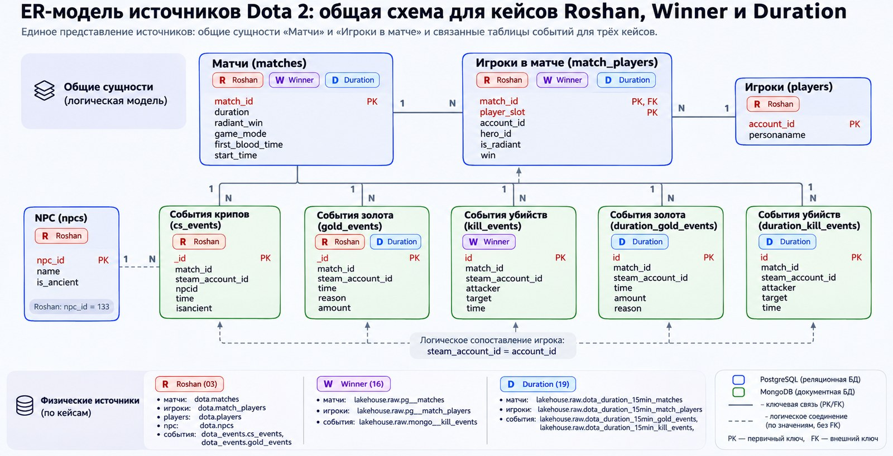

**Объём:** 322 343 матча за 14–15 октября (19 ч 23 мин). Размеры выборок по кейсам:

| Кейс | Выборка |
|---|---|
| Roshan | 321 266 матчей в базе сравнения |
| Winner | 13 101 матч (holdout 2 621) |
| Duration | 7 391 матч в MART (holdout 1 479); в профилировании исходного набора было 20 972 матча, gold events есть у 13 043 (~62,2%) |

---

## Пайплайн: RAW → STAGE → MART

Путь данных: **источники → RAW → STAGE → MART → Trino → Superset / ноутбук**.

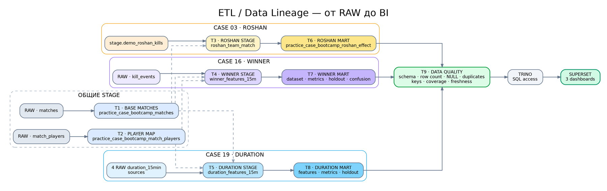

| Этап | Что происходит |
|---|---|
| 01 · RAW | Spark читает исходные Iceberg-таблицы каталога `lakehouse` |
| 02 · Проверки | Схемы, ключи, дубликаты, NULL, временные границы, покрытие событий |
| 03 · STAGE | Нормализация матчей, игроков и событий; агрегация до нужной гранулярности |
| 04 · MART | Отдельные датасеты под Roshan, Winner, Duration |
| 05 · Публикация | Запись в Iceberg (`writeTo` / `publish_table`), lineage через OpenLineage / Marquez |

Расчёт идёт отдельно по каждому кейсу: свой Airflow DAG, своя STAGE/MART-цепочка, свой дашборд. Общий слой (`matches`, `match_players`) описан в плане задач T1–T9.

**Правила STAGE и аномалии**, которые нашли при профилировании:
- Сторону, взявшую Рошана, определяем по last hit из `cs_events` (66,5% убийств), затем по командной выплате из `gold_events` (28,6%). У 4,93% событий сторона неизвестна, они не попадают в расчёт. Источник фиксируется в `team_source`.
- В событиях убийств `attacker` оказался `hero_id`, а не `account_id`, поэтому ключи пришлось сопоставлять отдельно.
- Отрицательные временные метки: 150 973 события золота и 3 193 убийства. Для признаков берём только `[0, 900)`.
- Отсутствие события отделяем от отсутствия данных и храним coverage-флаги: пропуски не заменяем нулями.
- 1 761 матч (0,86%) есть в событиях, но отсутствует в `matches`.

---

## Кейс 03 · Roshan: контроль объекта и исход матча

**Вопрос:** связан ли ранний или повторный контроль Рошана с вероятностью победы?
**Метод:** одна строка = один матч; win rate Radiant по группам, сравнение с базой (52,66%), 95% доверительные интервалы Уилсона, срез по корзинам длительности.

| Гипотеза | Результат | Статус |
|---|---|---|
| **R1** Первый Рошан и победа | Radiant взял первым: 76,53% (n = 98 659); Dire взял первым: 26,04% (n = 99 065); Рошана не было: 54,94% (n = 123 542). Разрыв над базой около +23,9 п.п. | Подтверждена по направлению |
| **R2** Определение стороны | Правило `cs → gold → unknown`, неизвестные 4,93% исключены | Решена как правило качества данных |
| **R3** Больше убийств = выше шанс | 0 → 18,23%; 1 → 73,84%; 2 → 76,94%; 3 → 74,54%; 4+ → 74,04%. Скачок только между нулём и единицей | Не подтверждена в линейной форме |
| **H2b** Доля контроля | 0% → 18,2%; 1–49% → 43,0%; 50–74% → 51,9%; 75–99% → 60,9%; 100% → 85,1% | Подтверждена по направлению |
| **R4** Поздний Рошан слабее связан с исходом | В матчах 10–19 мин: 95,9% против 7,5%; 60–69 мин: 50,5% против 47,3%; после 70 мин около 50/50 | Частично подтверждена |

**Ограничение:** это ассоциация, а не причина. Сильная команда чаще идёт на Рошана, поэтому утверждать, что именно Рошан приносит победу, нельзя.

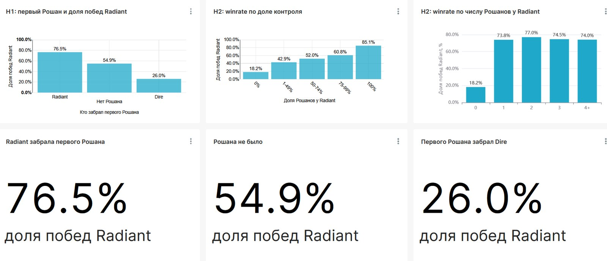

*Дашборд Superset, слайд 18. Остальное по кейсу: DAG, lineage и вторая панель.*

<details>
<summary>Airflow DAG, Marquez lineage и вторая панель дашборда</summary>

**Airflow DAG** (слайд 9). Два DAG на Spark: сначала STAGE, потом MART.

`stage__mart_roshan_match`: `raw.pg__match_players` + `raw.mongo__gold_events` + `raw.mongo__cs_events` → `stage.mart_roshan_match`

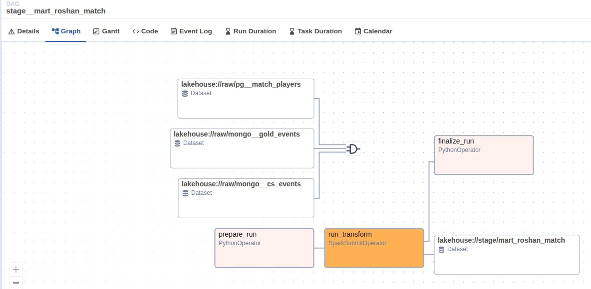

`mart__roshan_match_summary`: `stage.mart_roshan_match` + `raw.pg__matches` → `mart.roshan_match_summary`

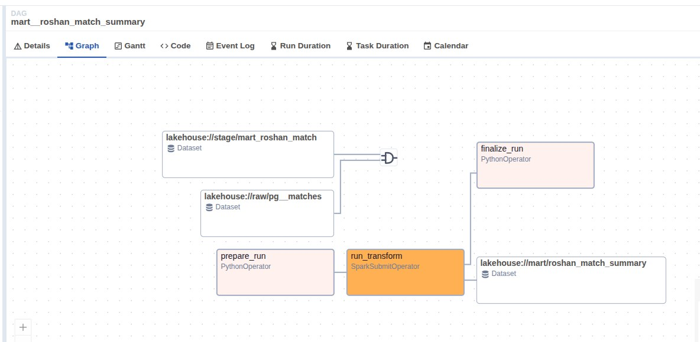

**Marquez lineage** (слайд 14). Цепочка от источников (PostgreSQL, MongoDB) через ingest-задачи и RAW до витрин и задачи проверки качества.

Выделен узел `lakehouse.stage.mart_roshan_match`:

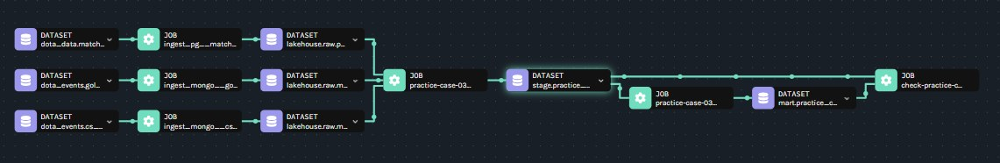

Выделен узел `lakehouse.mart.roshan_match_summary`:

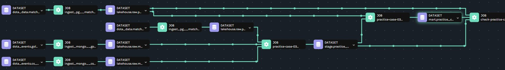

**Superset** (слайд 19). Динамика показателей и объём выборки:

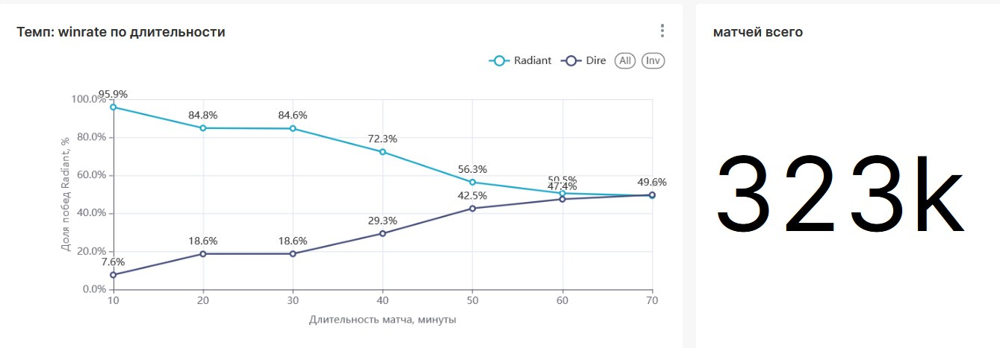

</details>

---

## Кейс 16 · Winner: прогноз победителя по первым 15 минутам

**Вопрос:** можно ли предсказать `radiant_win`, используя только то, что известно к 15-й минуте?
**Метод:** одна строка = один матч; train/test без смешивания матчей, Dummy baseline против Random Forest (300 деревьев, `max_depth=10`, медианная импутация), метрики ROC-AUC, F1, balanced accuracy, confusion matrix.

| Гипотеза | Результат | Статус |
|---|---|---|
| **W1** Отрыв по золоту > 5 000 даёт победу в ≥ 70% матчей | Win rate Radiant растёт от 16,2% (дефицит > 5 000) до 87,1% (преимущество > 5 000) | Подтверждена |
| **W2** Убийства различают исход | Медиана одинакова (27), Spearman ρ = −0,006, p = 0,50 | Не подтверждена |
| **W3** Первая кровь различает исход | Медиана 57 с в обеих группах, ρ = −0,001, p = 0,88 | Не подтверждена |
| **W4** Урон по башням различает исход | ρ = 0,0004, p = 0,96 | Не подтверждена |
| **W5** Модель лучше baseline | Random Forest: accuracy 72,99%, balanced accuracy 73,16%, F1 73,30%, **ROC-AUC 81,20%**. Dummy: 52,84% / 50,00% | Предварительно подтверждена |

**Вывод:** золото к 15-й минуте — главный ранний сигнал, а убийства, first blood и урон по башням по отдельности связи с исходом не показали.
**Ограничения:** случайный split даёт предварительную оценку, перед live-применением нужны временная валидация и проверка калибровки.

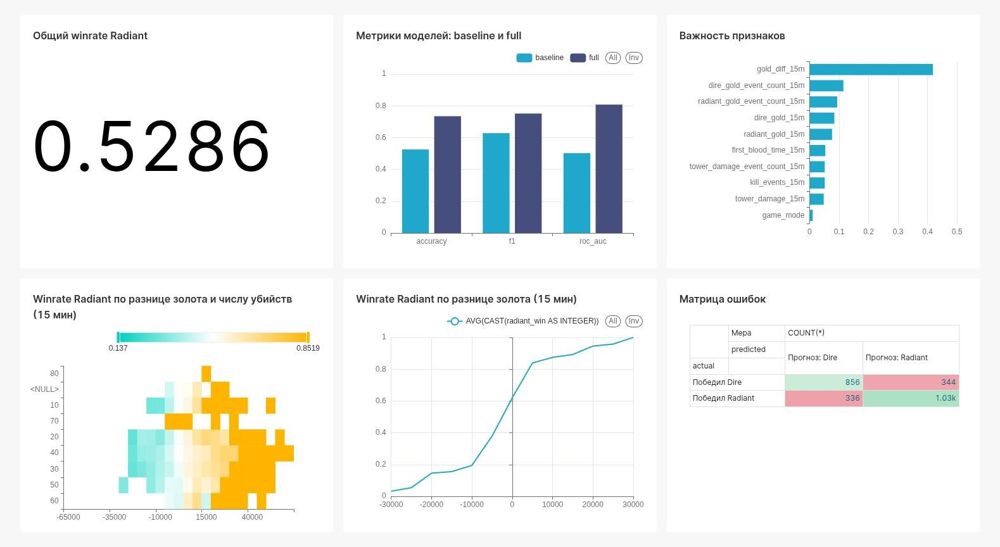

*Дашборд Superset, слайд 20. Остальное по кейсу: DAG и lineage.*

<details>
<summary>Airflow DAG и Marquez lineage</summary>

**Airflow DAG** (слайд 10). Четыре DAG по порядку расчёта: карта игроков по командам → признаки первых 15 минут → датасет Winner → ML-витрина.

`stage__case16_player_team_map`: `stage.case16_match_scope` + `raw.dota_duration_15min_match_players` → `stage.case16_player_team_map`

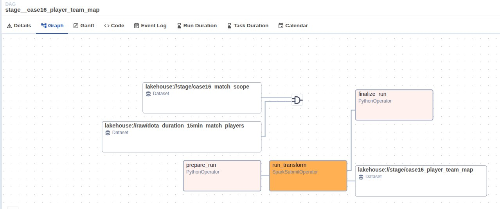

`stage__case16_winner_features_15m`: `stage.case16_player_team_map` + `stage.case16_match_scope` + `raw.dota_duration_15min_gold_events` / `kill_events` / `tower_damage_events` → `stage.case16_winner_features_15m`

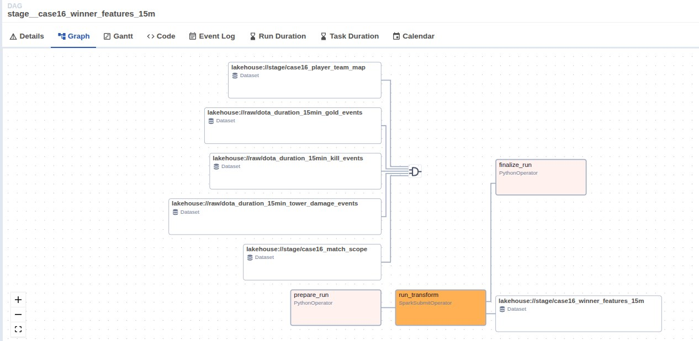

`mart__case16_winner_dataset`: `stage.case16_winner_features_15m` + `raw.pg__matches` → `mart.case16_winner_dataset`

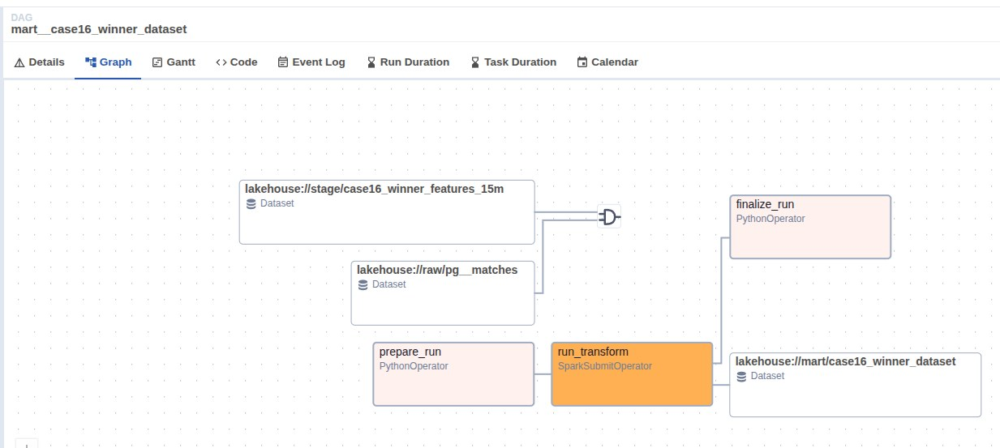

`mart__case16_ml_full`: `mart.case16_winner_dataset` → `mart.case16_ml_full`

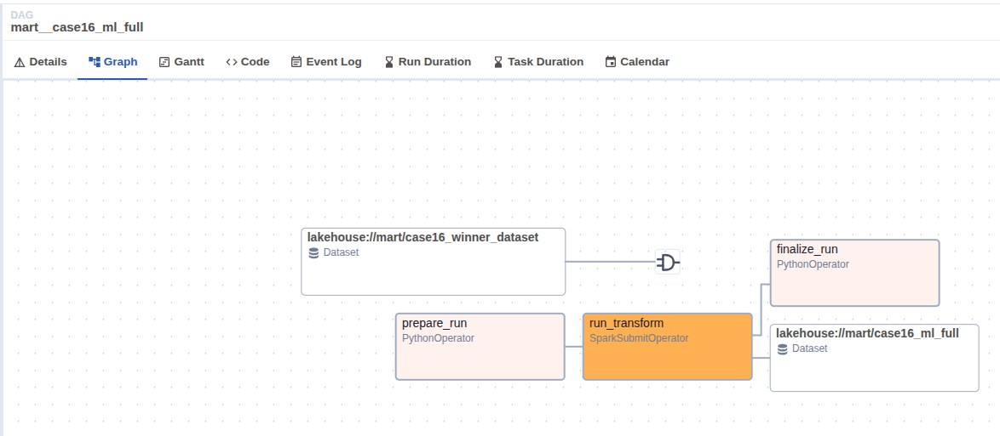

**Marquez lineage** (слайд 15). Сквозная цепочка Winner: ingest из PostgreSQL и MongoDB → RAW → STAGE → MART.

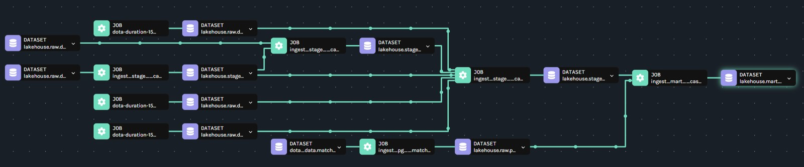

</details>

---

## Кейс 19 · Duration: оценка длительности матча

**Вопрос:** можно ли оценить итоговую длительность матча по событиям первых 15 минут?
**Метод:** регрессия `label_duration` (секунды) на признаки окна `[0, 900)`; Median baseline против Gradient Boosting (200 деревьев, `learning_rate=0.05`, `max_depth=2`); метрики MAE, RMSE, R²; анализ остатков и матрица попаданий по диапазонам длительности.

| Модель | MAE, с | RMSE, с | R² |
|---|---:|---:|---:|
| Median baseline | 531,8 | 668,9 | −0,002 |
| Gradient Boosting | **361,4** | **471,9** | **0,501** |

Критерий D5 (снижение MAE и RMSE не менее чем на 25%) выполнен: **−32,1%** и **−29,4%** на holdout из 1 479 матчей. Два главных признака по важности: `radiant_gold_15m` (0,488) и `dire_gold_15m` (0,243).

| Гипотеза | Статус |
|---|---|
| D1 Отрыв по золоту ≥ 5 000 сдвигает медиану длительности на ≥ 3 мин | Не проверена в виде сравнения групп |
| D2 Активность убийств сдвигает медиану длительности | Не подтверждена; пороговый тест не проведён |
| D3 ≥ 2 потерянных башен сокращают матч на ≥ 3 мин | Не проверена |
| D4 Пропуски в признаках повышают MAE на ≥ 20% | Не проверена |
| D5 Gradient Boosting лучше медианного baseline на ≥ 25% | **Подтверждена** |

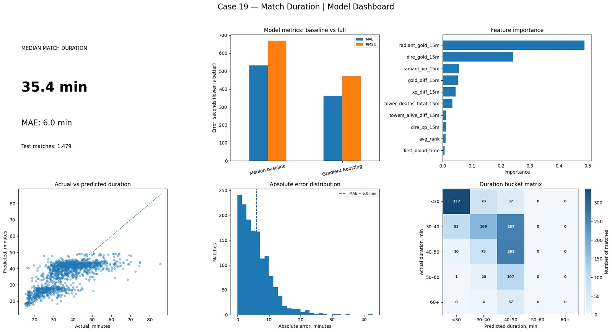

*Дашборд Duration, слайд 21. Остальное по кейсу: DAG и lineage.*

<details>
<summary>Airflow DAG и Marquez lineage</summary>

**Airflow DAG** (слайд 11). `stage__case17_duration_prediction_features`: `raw.pg__matches`, `raw.pg__match_players` и события из MongoDB (`cs_events`, `gold_events`, `kill_events`, `tower_damage_events`, `tower_death_events`) → `stage.case17_duration_prediction_features`

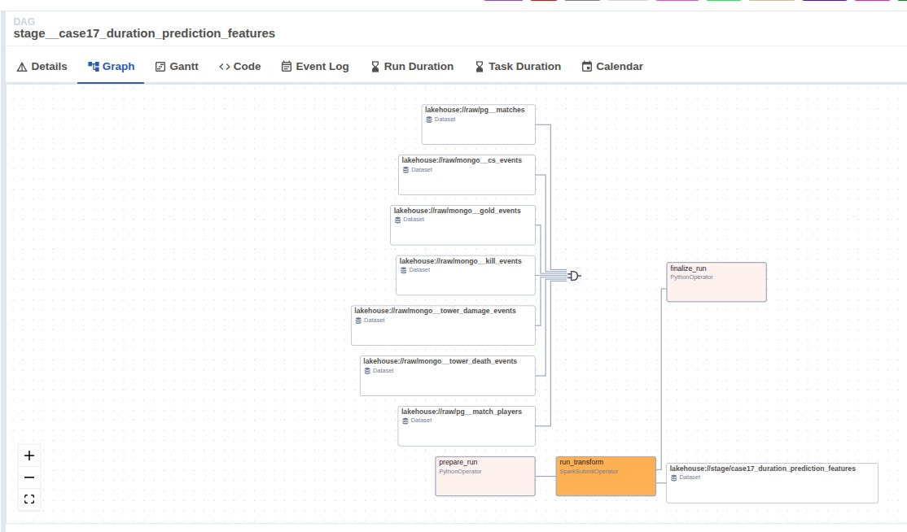

**Marquez lineage** (слайд 16). Ingest-задачи для PostgreSQL и MongoDB → RAW → задача `case-17-stage-features` → STAGE → задача `case-17-mart-model` → MART.

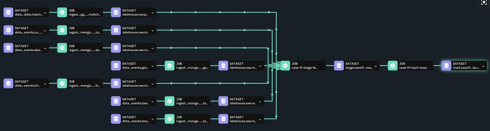

</details>

---

## Ограничения и известные проблемы

- **Корреляция, а не причинность.** Это касается Roshan и feature importance во всех кейсах.
- **Split случайный.** Для Winner и Duration нужна временная валидация, а для Winner ещё и проверка калибровки вероятностей.
- **Режимы игры смешаны** (Turbo и All Pick), поэтому распределение длительности неоднородно. Нужно сравнение со средним по режиму и анализ ошибок по диапазонам длительности.
- **D1–D4 не закрыты.** Код проверок есть в ноутбуке, но результатов в сохранённом выполнении нет.
- **Winner и Roshan:** в сохранённом ноутбуке у ячеек нет outputs. Цифры взяты из презентации и исходных ноутбуков команды.
- **Покрытие.** Gold events есть примерно у 62% матчей Duration, около 5% событий Roshan без определённой стороны.
- **Расхождения в именах объектов:** в разных местах встречаются `practice_case_16_winner_dataset` и `case16_winner_dataset`, `roshan_match_summary` и `practice_case_bootcamp_roshan_effect`, а в Airflow Duration-DAG называется `case17_duration_prediction_features`. Фактические имена нужно сверять с каталогом.
- **Размер Duration:** в профилировании 20 972 матча, в MART, на которой обучалась модель, 7 391.

---

## Структура репозитория

```
.
├── README.md
├── notebooks/
│   └── dota2_cases_03_16_19.ipynb     # единый ноутбук: профилирование, гипотезы, модели, дашборды
├── presentation/
│   └── dota2_team5_slides.pdf         # презентация проекта (28 слайдов)
└── docs/
    └── img/                           # ER, lineage, DAG, дашборды
```

---

## Как запускали

Расчёты шли на закрытой учебной платформе буткемпа. После завершения буткемпа доступ к ней закрыт, поэтому повторить расчёт из этого репозитория нельзя.

Как это было устроено:
1. STAGE и MART строили на платформе DAG'ами Airflow (Spark), ноутбук читал готовые витрины через Trino.
2. Ноутбук запускали в Colab, зависимости ставили командой `pip install trino pandas scikit-learn scipy matplotlib joblib`.
3. К Trino подключались по адресу сервера платформы (каталог `lakehouse`); в публичной версии адрес убран.
4. Ноутбук прогоняли сверху вниз: подключение → инвентаризация → профилирование → кейсы 03, 16, 19.

В репозитории остались ноутбук с сохранёнными outputs профилирования и Duration, презентация и скриншоты DAG, lineage и дашбордов. По ним результаты можно проверить без запуска.

---

## Команда

| Участник | Роли | Зона ответственности |
|---|---|---|
| Емельянов Кирилл | BA, Data/ML Analyst | Бизнес-постановка, кейсы Roshan и Winner, гипотезы и метрики, постановка Duration |
| Кренев Михаил | DE, Data/ML Analyst | Исследование источников, качество и покрытие, RAW mapping, ER-модель |
| Намажап Чингис | DE, Data Analyst | Аудит источников, STAGE/MART, ключи, Data Quality, ноутбук, lineage, дашборд, подготовка данных и анализ Duration |
| Машков Юрий | BA | Бизнес-анализ |

<!-- TODO: каждому участнику уточнить личный вклад -->

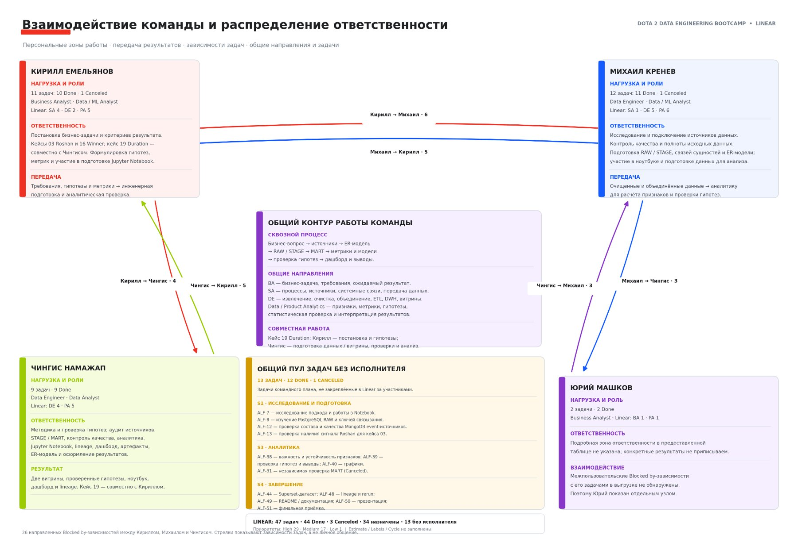

---

## Итог

**Что сделали.** Прошли путь данных Dota 2 от источников (PostgreSQL, MongoDB) до дашбордов на lakehouse-стеке: Spark, Iceberg на S3, Trino, Airflow, Superset, Marquez. По трём кейсам собрали витрины, проверили гипотезы и обучили две модели.

**Что получилось технически.** Winner: ROC-AUC 0,81, accuracy 73,0% против 52,8% у baseline. Duration: MAE ниже на 32% относительно медианного baseline. Roshan: связь контроля с победой есть, но это ассоциация, а не причина. Гипотезы D1–D4 по Duration остались непроверенными.

**Что это даёт заказчику.** Показатели для оценки командной игры (доля контроля Рошана), сигнал для live-аналитики (золото к 15-й минуте) и ориентировочная оценка длительности матча с ошибкой около 6 минут. Для каждого результата описаны границы применимости и проблемы данных, которые надо закрывать до промышленного использования.

**Как работали.** Хотя жёсткие сроки привели к смешению ролей и отступлению от чистого agile, за четыре дня буткемпа довели три кейса от ER-модели до дашбордов. Задачи вели в Linear: на момент презентации 47, из них 44 выполнены и 3 отменены. Работали согласованно и при необходимости брали на себя задачи друг друга.
